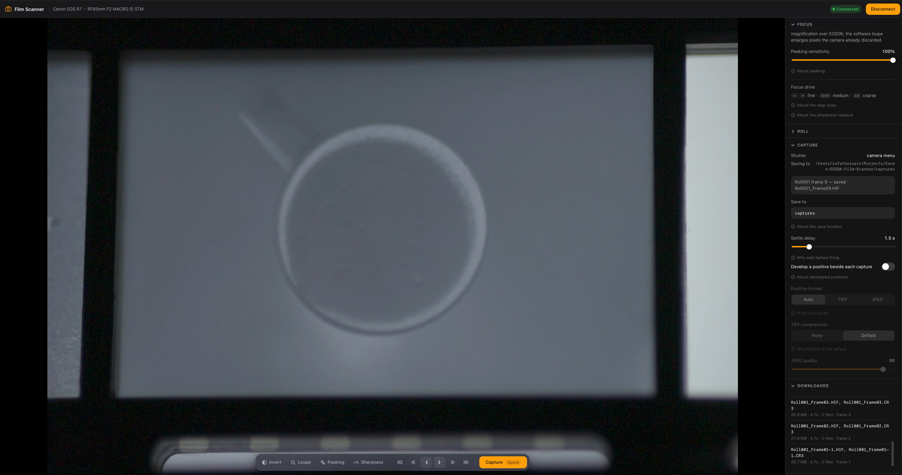

# Canon EDSDK Film Scanner

[](https://github.com/RafatH0ssain/Canon-EDSDK-Film-Scanner/actions/workflows/tests.yml)

I scan my film negatives with a Canon R7 on a copy stand. Pressing the shutter by hand shook the
whole rig, and checking focus on grain on the camera's little screen was a pain. So this controls
the camera over USB from my laptop instead, with the live view already inverted to a positive.


There's also a [Wi-Fi version](https://github.com/RafatH0ssain/Canon-Smart-Film-Scanner), but it
only got about 4 fps on my camera. Over USB it runs at around 60 fps, so this is the one I use.
After scanning, I use [Film Scan Darkroom](https://github.com/RafatH0ssain/Film-Scan-Darkroom) to
crop and invert the roll.

## What it does

- Live view inverted to a positive, for colour or black and white film
- Focus peaking, a loupe to zoom into the grain, and a sharpness number to focus by
- Focus and shutter from the laptop, so nothing on the stand gets touched
- Saves each scan as `Roll014/Roll014_Frame07.CR3`, with a `roll.json` noting the film stock,
  developer and date
- Can also save a 16-bit positive TIFF next to each RAW if you want one



## What you need

A Canon camera that EDSDK supports (I use an R7), a macro lens that gets close to 1:1, a copy
stand, a negative holder and a backlight. A normal USB cable straight into the laptop is enough.

## Running it

You need Canon's EDSDK from their [developer site](https://developercommunity.usa.canon.com/).
Canon doesn't allow sharing it, so put it in `edsdk_sdk/` (git-ignored) and point
`edsdk.library_dir` in `config.yaml` at it. Without it, the app still runs on a fake camera.

```bash
python -m venv .venv
.venv/bin/pip install -r requirements.txt -e .
.venv/bin/python -m cefs.app.server
```

Then open http://127.0.0.1:8000 and press Connect. Turn off the camera's Wi-Fi and Bluetooth
first or it won't show up over USB. On a Mac, also quit Photos and Image Capture, since they grab
the camera when it's plugged in.

Keys: Space to capture, arrow keys to focus, I to invert, L for the loupe, P for peaking.

`python packaging/build_app.py` builds a double-clickable app (needs `pip install pyinstaller`).

## Licence

MIT. Packaged builds are GPL v2 because of pillow-heif, see [THIRD-PARTY-NOTICES.md](THIRD-PARTY-NOTICES.md).
