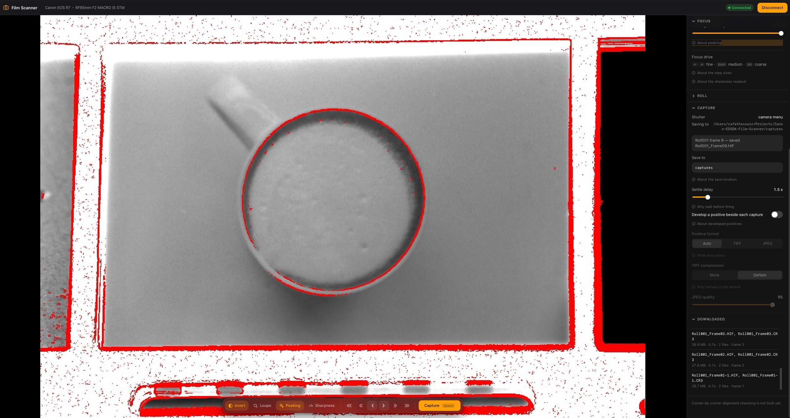

# Canon EDSDK Film Scanner

[](https://github.com/RafatH0ssain/Canon-EDSDK-Film-Scanner/actions/workflows/tests.yml)

I scan my film negatives with a Canon camera on a copy stand, and pressing the shutter by hand
shook the rig and judging focus on grain on the back screen was miserable. So this drives the
camera over USB from my computer instead: a big live view that's already inverted to a positive,
focus peaking and a loupe to nail focus, and remote focus and shutter so nothing gets touched.
It's verified on an EOS R7 from macOS and Windows.



It has a wireless sibling, [Canon Smart Film Scanner](https://github.com/RafatH0ssain/Canon-Smart-Film-Scanner),
which needs no SDK. Over the R7's Wi-Fi it only managed about 4 fps though, against about 60 fps
over USB here, which is why this one exists. Once a roll is scanned,
[Film Scan Darkroom](https://github.com/RafatH0ssain/Film-Scan-Darkroom) crops, inverts and
exports it.

## Running it

You need Canon's EDSDK, which Canon licenses per developer and doesn't let anyone redistribute,
so get your own from [Canon's Developer Community](https://developercommunity.usa.canon.com/) and
keep it outside the repo or in `edsdk_sdk/`, which is git-ignored. Then, with Python 3.10 to 3.13:

```bash
python -m venv .venv
.venv/bin/pip install -r requirements.txt -e .
.venv/bin/python -m cefs.app.server
```

Open <http://127.0.0.1:8000/> and press Connect. Without a camera it runs on a synthetic negative,
which is enough to try everything. For the real thing, copy `config.example.yaml` to
`config.yaml`, set `camera.use_mock: false` and point `edsdk.library_dir` at the SDK.

Turn the camera's Wi-Fi and Bluetooth off first. A Canon body drops USB data while wireless is
on, and all you see is zero cameras detected. On macOS, also quit Image Capture and Photos, and
re-sign Canon's framework, which ships with its signature broken:

```bash
xattr -cr edsdk_sdk/Framework/EDSDK.framework
codesign --force --deep --sign - edsdk_sdk/Framework/EDSDK.framework
```

Keys: <kbd>Space</kbd> capture, <kbd>←</kbd><kbd>→</kbd> focus (<kbd>Shift</kbd> and <kbd>Alt</kbd>
for bigger steps), <kbd>I</kbd> invert, <kbd>L</kbd> loupe, <kbd>P</kbd> peaking.

`python packaging/build_app.py` (after `pip install pyinstaller`) builds a double-clickable app.
It still needs your own copy of EDSDK, and the build fails if any of Canon's files end up inside it.

## How it works

Scans land in `captures/Roll014/Roll014_Frame07.CR3` with a `roll.json` beside them recording the
stock, developer and date. RAW goes through LibRaw, since EDSDK can't decode CR3 itself, and a
16-bit positive can be developed next to each capture if you want one. On macOS the SDK only
finds cameras from the main thread, so the web server runs on a worker instead.

| Folder | What's in it |
|---|---|
| `src/cefs/edsdk/` | ctypes bindings and the one thread that owns the SDK |
| `src/cefs/processing/` | inversion, peaking, sharpness, RAW and HEIF decoding |
| `src/cefs/app/` | the local web server and browser UI |
| `src/cefs/mock/` | a fake camera so none of this needs hardware |

`pytest` runs the tests, none of which need a camera or the SDK.

## Licence

The source is MIT. A packaged build is GPL v2, because pillow-heif's wheel bundles libx265; see
[THIRD-PARTY-NOTICES.md](THIRD-PARTY-NOTICES.md). Canon's EDSDK is Canon's, under its own terms.
