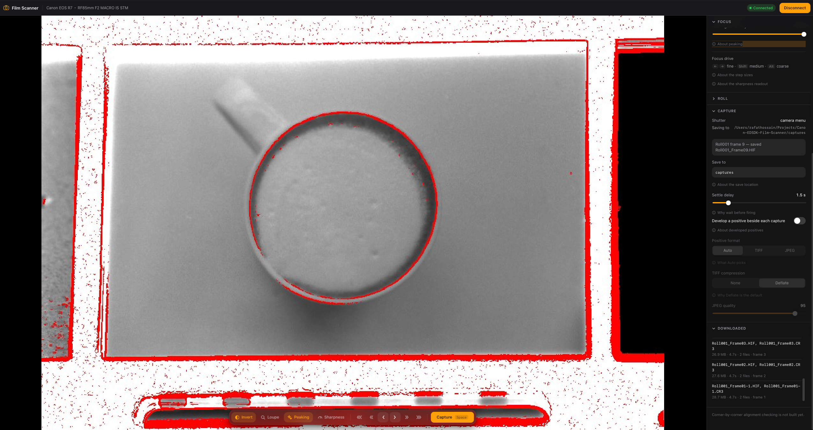
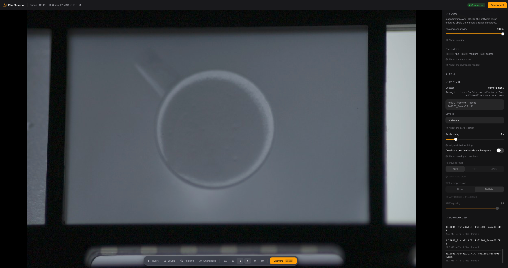

# Canon EDSDK Film Scanner

[](https://github.com/RafatH0ssain/Canon-EDSDK-Film-Scanner/actions/workflows/tests.yml)

Scan film negatives with a Canon camera on a copy stand: live positive preview, remote focus and shutter, over USB. Colour and B&W, verified on an EOS R7 from Windows and macOS.

## Preview

**Live Inversion & Focus Peaking**  


**Raw Negative View**  


## Why not the wireless one

The sibling **Canon Smart Film Scanner** does the same job over [CCAPI](https://developercommunity.usa.canon.com/) with no native dependencies and a plain `pip install`. Use it if wireless live view is fast enough.

It wasn't here. At 960×640:
| | fps | period | throughput |
|---|---|---|---|
| Wi-Fi (CCAPI) | 3.98 | 251 ms | 1.23 MB/s |
| **USB (EDSDK)** | **59.79** | **17 ms** | **15.33 MB/s** |

The R7 is Wi-Fi 4 on 2.4 GHz with no Ethernet and CCAPI has no USB transport, so the fix was changing SDK ([measurements](spike/README.md)).

What it costs: a USB cable, and you obtain EDSDK from Canon yourself. EDSDK never modifies firmware, so nothing is baked into the camera's files. All processing happens on the computer.

## Getting EDSDK

⚠️ **Canon licenses EDSDK per developer and it may not be redistributed.** This repo calls the SDK; it never contains it.

Register with [Canon's Developer Community](https://developercommunity.usa.canon.com/), check your body is supported, and download the SDK for your platform. Keep it in `edsdk_sdk/` (git-ignored) or outside the repo. Never commit headers, binaries, or Canon's reference text.

> The RAW-develop bundle adds nothing on macOS: its `DPP.framework` is **i386**, which macOS hasn't run since Catalina. RAW goes through LibRaw either way, which suits the inversion better.

## Hardware

A Canon body EDSDK supports (the **EOS R7** is the reference), a real data cable straight into the machine (USB 2.0 is enough for live view), and a macro lens near 1:1, copy stand, negative holder, and backlight (high-CRI for colour). Autofocus lenses can be driven from the PC; manual ones are focused by hand. Detected automatically.

## The app

A packaged build runs by double-clicking: no Python, no checkout. On first launch it creates **Documents/Canon EDSDK Film Scanner/**, writes a commented `config.yaml`, opens the UI, and starts on the mock camera.

**It does not include Canon's SDK, and can't.** Driving a real camera means getting your own copy and pointing `config.yaml` at it. Without it you get the full UI against a synthetic negative.

```bash
pip install pyinstaller
python packaging/build_app.py
```

Output lands in `dist/`, around **66 MB**. The build **fails rather than finishes** if Canon's files reach the output or a native library is missing from [THIRD-PARTY-NOTICES.md](THIRD-PARTY-NOTICES.md). For something permissive to hand out, the sibling **Canon Smart Film Scanner** has no copyleft components.

**Source is MIT; a built binary is GPL v2.** It bundles pillow-heif, whose wheel is GPLv2 because `libheif` hard-links **libx265**. Only the combined binary is GPL; giving one out means shipping the notices in [THIRD-PARTY-NOTICES.md](THIRD-PARTY-NOTICES.md) and `licenses/`.

macOS builds are unsigned, so Gatekeeper blocks them elsewhere. Locally, right-click → Open.

## Running from source

No SDK, no camera:

```bash
python -m venv .venv                              # 3.10-3.13, 64-bit
.venv/bin/pip install -r requirements.txt -e .    # Windows: .venv\Scripts\
.venv/bin/python -m cefs.app.server
```

<http://127.0.0.1:8000/>, press Connect, and you get a synthetic negative with grain, mask and rebate. Loopback only; it can fire your shutter.

<kbd>Space</kbd> capture · <kbd>←</kbd><kbd>→</kbd> focus (<kbd>Shift</kbd> medium, <kbd>Alt</kbd> coarse) · <kbd>I</kbd> invert · <kbd>L</kbd> loupe · <kbd>P</kbd> peaking · <kbd>S</kbd> sharpness

### With a real camera

**Turn the camera's Wi-Fi and Bluetooth off first.** A Canon body disables USB data while wireless is on, and the only symptom is `cameras detected: 0`. On macOS also quit Image Capture and Photos.

Copy `config.example.yaml` to `config.yaml`, set `camera.use_mock: false`, and point `edsdk.library_dir` at the folder holding `EDSDK.dll` or `EDSDK.framework`.

macOS needs the framework re-signed first (Canon ships it with the seal broken):

```bash
ditto "/Volumes/Macintosh 1/EDSDK/Framework/EDSDK.framework" edsdk_sdk/Framework/EDSDK.framework
find edsdk_sdk/Framework/EDSDK.framework -name .DS_Store -delete
xattr -cr edsdk_sdk/Framework/EDSDK.framework
codesign --force --deep --sign - edsdk_sdk/Framework/EDSDK.framework
```

The macOS 13.20.10 build is universal, so Apple Silicon needs no Rosetta.

```bash
.venv/bin/python -m cefs.tools.check_camera --focus   # --capture fires one shot
.venv/bin/python -m cefs.app.server
```

## Measured on an EOS R7

| | Windows | macOS |
|---|---|---|
| Live view, end to end | 59.79 fps | 27 / 48 / **71.7** at `target_fps` 30 / 60 / 120 |
| Live view, body's own rate | ~60 fps | 96.5 fps |
| Capture download | 26 MB/s | **31 MB/s** |
| Focus per press, fine / medium / coarse | 22 / 141 / 377 ms | 41 / 171 / 512 ms |
| Develop CR3 / HEIF | 4.9 s / 3.8–4.0 s | 5.4 s / 3.9 s |

Capture cycle ~3 s RAW only, ~15 s for RAW+HEIF. Focus steps are 1×1 fine, 2×6 medium, 3×20 coarse. Not over EDSDK: camera-side zoom and electronic shutter.

**Live view runs at the taking shutter speed.** With exposure simulation, 1/15 gives 15 fps. If focusing is choppy, check the shutter before the link.

## Capture formats

| Format | Decoder | Positive |
|---|---|---|
| RAW `.CR3`/`.CR2`, incl. CRAW | LibRaw (EDSDK cannot decode CR3, measured) | 16-bit TIFF |
| HEIF `.HIF` | pillow-heif, 10-bit, PQ transfer read from the file | 16-bit TIFF |
| JPEG | Pillow | JPEG |

Chosen by the file, not a setting. TIFF is written by `tifffile` because Pillow has no 16-bit-per-channel colour mode.

Compression is **none** or **deflate**, the default at 2.4–2.6× lossless on real 32 MP positives. To keep the RAW and develop elsewhere, set `capture.develop_positives: false`.


## Rolls and naming

`captures/Roll014/Roll014_Frame07.CR3`, `Roll014_Frame07-positive.tif`, `roll.json`.

Fields are `{roll}` `{frame}` `{original}` `{date}` `{time}` `{stock}`; `{frame:02d}` pads and `/` makes a folder. Leave the template empty to keep the camera's own names. **A frame is one shutter release, not one file**: RAW+HEIF sends two files sharing one frame number.

`roll.json` records stock, developer, date and notes, rewritten after every capture.

## Threading

One thread owns the SDK; everything else queues and waits. Windows accepts any single-threaded-apartment thread with a message pump. macOS needs **the main thread**: `EdsGetCameraList` returns zero cameras anywhere else, so the web server runs on a worker instead (`edsdk/mainthread.py`).

Live view is polled, so a working preview is not proof the threading is right. The first thing to break is a capture that never completes.

## Limitations

- Corner-by-corner alignment isn't built; the per-region sharpness it needs is.
- No batch re-develop of a roll already scanned.
- Linux is refused outright rather than half-working.

## Layout

`src/cefs/` holds the contract (`backend.py`), config, naming, the `edsdk/` bindings and SDK thread, pure `processing/`, the local `app/` UI, a `mock/` backend, and `tools/`. Alongside it: `packaging/` (PyInstaller), `tests/` (~250, no camera or SDK needed), `spike/` (the CCAPI vs EDSDK measurements), and `TESTING.md` (hardware test plan).

## Contributing

Keep the layers decoupled and add tests for anything in `processing/`. Never commit EDSDK headers or binaries, Canon's reference text, camera serial numbers, or your own scans.

## Licence

Source is MIT, covering this project's code only. A packaged binary is GPL v2 for the pillow-heif reason above. Canon's EDSDK and its documentation are Canon's property; nothing here grants you rights to them.
